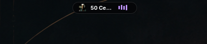
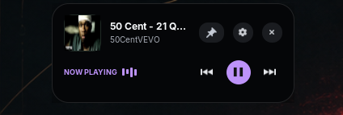
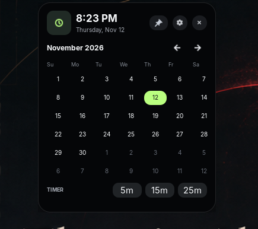

# Nova

**A lightweight, Apple-inspired Dynamic Island for GNOME Shell.** Smooth animations, music controls, live desktop activities, a clock and calendar — **no AI, Electron, or background daemon**.

[](https://github.com/tobiasGuta/N-va/actions/workflows/ci.yml)
[](https://github.com/tobiasGuta/N-va/releases/tag/v0.7.0)

**[Get Nova v0.7.0](https://github.com/tobiasGuta/N-va/releases/tag/v0.7.0)** · **[Installation](#install-on-fedora-gnome)** · **[Preferences](#preferences)** · **[Report a bug](https://github.com/tobiasGuta/N-va/issues/new/choose)**

### Screenshots


<table>
  <tr>
    <td width="34%" align="center">
      
      <br/>
      <sub>Compact island with floating top bar</sub>
    </td>
    <td width="33%" align="center">
      
      <br/>
      <sub>Expanded MPRIS music card</sub>
    </td>
    <td width="33%" align="center">
      
      <br/>
      <sub>Additional music island preview</sub>
    </td>
  </tr>

  <!-- Second row -->
  <tr>
    <td colspan="3" align="center">
      
      <br/>
      <sub>Menu</sub>
    </td>
  </tr>
</table>


<sub>Real Fedora screenshots provided during development and cropped to highlight Nova. Some controls in the captures have since been refined.</sub>

## What's new in v0.7.0

**Nova now displays richer GNOME notifications.** Expanded previews separate
the app name, title and message text; use an app-provided icon where available;
and show a **bounded FIFO queue** instead of replacing every new alert.
When multiple alerts arrive, up to six wait their turn and a small `+N`
counter shows how many remain. Notification content is rendered as bounded,
plain text.

**Privacy and GNOME integration:** Nova does not store a second notification
history. GNOME keeps its existing notification history, critical alerts stay
native, and new alerts fall back to GNOME's banners when Nova cannot display
them or its queue is full. Apps that bypass GNOME's notification system may
not appear.

**Tested on Fedora:** The maintainer confirmed that notification previews
work well with other real desktop applications. Automated tests, schema
validation, and packaging CI also pass. Lock-screen, queue-overflow, other
GNOME versions, and long-term performance still need wider verification.

See the [v0.7 release notes](docs/releases/v0.7.0.md) and
[notification testing guide](docs/NOTIFICATIONS.md).

## What's new in v0.6.0

This release builds on Fedora-tested v0.5.4, adding five capsule themes
(Custom, Mint, Ocean, Violet, Sunset), an optional keyboard shortcut,
more efficient music and activity rendering, a music-visualizer toggle,
and a **disabled-by-default local D-Bus API** for developer activity cards.

The changes have passed automated JavaScript and package checks and
the maintainer's Fedora desktop tests for **themes, shortcut, developer API,
music, downloads, notifications, and enable/disable behavior**.
Tests have not yet established performance metrics or runtime
compatibility on every GNOME 49–51 setup.

See the [release notes](docs/releases/v0.6.0.md),
[roadmap](docs/ROADMAP.md),
[developer activity API](docs/developer-api.md),
[architecture](docs/ARCHITECTURE.md), and
[manual test plan](docs/TESTING.md).

## Core features

- Compact, centered black pill fitted to the GNOME panel height, with smooth expand/collapse and content fade-in.
- Default compact clock with local time and weekday; expanded month-view calendar with navigation.
- Music card only while a compatible MPRIS player reports `Playing`; pauses and stops return to the clock.
- Floating-panel mode removes GNOME's top bar background but retains left/right controls.
- A rounded black expanded media card, styled independently of custom GNOME themes.
- Album art for MPRIS `mpris:artUrl` (local files or bounded HTTPS downloads), with fallback music icons.
- Animated playback bars in both compact and expanded media views; a decorative activity indicator rather than a live audio spectrum.
- Gentle cross-fades as Nova morphs from the calendar to music and back.
- Play/pause, previous and next buttons (when the player supports them).
- Hover to expand; use an icon-only pin button to keep Nova open while using other apps; close to collapse.
- Countdown timers (5, 15, or 25 minutes) launched from the calendar and shown as live activities.
- Rich GNOME notification previews with app names, message bodies, available app icons and a bounded FIFO queue; optional Nova-only banners preserve GNOME history and critical alerts.
- Faster signal-driven volume indicators from GNOME Quick Settings and brightness updates from Mutter.
- Optional experimental replacement of GNOME’s volume/brightness OSD with Nova’s own overlays, with safe restoration when disabled.
- GNOME built-in screencast activity with elapsed time.
- Download activity and completion previews from the XDG Downloads folder using asynchronous scans and filesystem events, including received bytes when possible (no invented percentages).
- Native settings window for sizes, accent color, animation duration, floating bar, and individual activity toggles.
- Automatically discovers MPRIS players and follows playback changes.
- Restores the original GNOME center clock when disabled.
- Respects GNOME 51 reduced-motion preference; no AI or subprocesses. Optional HTTPS requests occur only for remote cover art during playback.

**Status:** v0.7.0 is the latest Fedora-tested stable release, targeting GNOME Shell 49–51. Not all GNOME versions and themes have been independently verified; live activities use Shell APIs that may vary between setups. The calendar is local-only (no appointments). Nova can replace ordinary banners when the optional Nova-only setting is enabled; GNOME's critical alerts remain native.

## Install on Fedora GNOME

1. Confirm that you are running GNOME Shell, not KDE Plasma:

   ```bash
   echo $XDG_CURRENT_DESKTOP
   gnome-shell --version
   ```

2. For the tested source installation, clone and install locally (or get the ZIP from the [v0.7.0 release](https://github.com/tobiasGuta/N-va/releases/tag/v0.7.0)):

   ```bash
   git clone https://github.com/tobiasGuta/N-va.git
   cd N-va
   bash ./install.sh
   ```

3. **Log out and back in** on a Wayland session, then enable:

   ```bash
   gnome-extensions enable nova@tobiasguta.github.io
   ```

   If the extension isn't listed, verify that it is installed at `~/.local/share/gnome-shell/extensions/nova@tobiasguta.github.io/` and log out/in once more.

To disable Nova and restore the original clock:

```bash
gnome-extensions disable nova@tobiasguta.github.io
```

To uninstall it completely, disable it first, then run:

```bash
rm -r "$HOME/.local/share/gnome-shell/extensions/nova@tobiasguta.github.io"
```

## Artwork and privacy

Nova reads `mpris:artUrl` only while an MPRIS client reports active playback. Local cover files load directly. Remote covers use HTTPS only (no redirects, IP literals, localhost, custom ports, or HTTP), with an 8-second timeout and 2 MB data limit. A small in-memory cache is released when Nova is disabled; no disk cache is created.

Remote cover images do cause HTTPS requests to the provider's image server. If artwork is missing or unsupported, Nova falls back to a note icon.

The four moving bars are a **synthetic playback animation**, not a live waveform. Nova does not capture or inspect audio.

## Music player compatibility

Nova reads `org.mpris.MediaPlayer2.*` services from the user's session D-Bus. Spotify, VLC and some browsers expose MPRIS interfaces. Browser media support depends on the browser's settings and the current playback session. Nova displays music only when the selected player is actively playing, and returns to the clock when playback pauses or stops.

Useful optional diagnostic tool:

```bash
sudo dnf install playerctl
playerctl -l
playerctl metadata
```

`playerctl` is **not** a Nova runtime dependency.

## Preferences

New in v0.6.0: appearance includes theme presets (Custom, Mint,
Ocean, Violet, Sunset), an optional shortcut (off by default), and a toggle
for animated music bars. In Live activities, opt in to the local developer API
only if you want same-user apps to display short status messages.

Open **Extensions → Nova → Preferences**, click the small gear button inside Nova’s expanded calendar or music player, or run:

```bash
gnome-extensions prefs nova@tobiasguta.github.io
```

Adjust the compact/expanded widths, accent color (hex `#RRGGBB`), animation speed, floating top bar, and individual activity features. The installer now compiles an extension-local GSettings schema. If you install manually, include `prefs.js` and the `schemas/` directory.

## Privacy indicators

The current source on `main` shows privacy activity at the right edge of the
compact capsule. Expand Nova to read which activities are active.

| Indicator | Meaning |
| --- | --- |
| Orange dot | Microphone in use. System mute clears the microphone status. |
| Green dot | Camera in use. The expanded summary also mentions the microphone when both are active. |
| Blue location arrow | GNOME Location Services are active. |
| Pink screen-sharing icon | GNOME reports screen sharing. |

The indicators are on by default. Turn them off in **Nova Preferences →
Appearance → Privacy indicators**. Nova reads the activity state GNOME Shell
already reports and leaves the native indicators visible. Camera access
outside GNOME's PipeWire monitor and location requests outside GNOME Location
Services can go undetected. The v0.7.0 release ZIP predates this feature.
See the [Fedora test steps](docs/TESTING.md#privacy-indicators).

## Live activity coverage

- **Timer:** Start a 5-, 15-, or 25-minute countdown in the expanded calendar. It remains visible until stopped or finished.
- **Notifications:** Nova previews regular GNOME notification titles. In **Nova-only notification banners** mode, it acknowledges the incoming normal alert before GNOME displays a second banner, while leaving the notification in GNOME's history. Critical alerts remain native. Disable the Nova-only switch to see both banners. If you previously turned off **Show notifications in Nova**, turn it back on in preferences; GSettings retains explicit choices across upgrades.
- **Volume / brightness OSD:** GNOME normally shows its own OSD as well as Nova. The **Replace native volume/brightness OSD** preference now defaults to on for new installs. You can turn it off to keep GNOME's overlays. When enabled, Nova reads the volume/brightness percentage from the same GNOME OSD event, renders it directly, and suppresses only that native popup. Unsupported GNOME overlays remain intact. Existing saved settings may override the new default; check the preferences switch if two popups remain. Disabling Nova restores the original GNOME methods.
- **Volume:** Mirrors output-volume changes from compatible GNOME Quick Settings stream objects.
- **Brightness:** Uses GNOME's active Quick Settings slider as the authoritative source to avoid incorrect jumps between readings. Falls back to Mutter's `org.gnome.Mutter.DisplayConfig.Backlight` property only when the slider is unavailable. Some hardware may not expose either.
- **Screen recording:** The recording timer tracks GNOME Shell's built-in screencast. The separate privacy icon follows GNOME's screen-sharing status.
- **Downloads:** Nova uses your configured XDG Downloads directory (fallback `~/Downloads`) and listens for Gio file-monitor events, with asynchronous folder scans every ~2.4 seconds as a fallback. Rename completions are checked immediately, and direct-to-final files receive a follow-up scan after ~700 ms rather than waiting for the next fallback poll. It recognizes Firefox `.part` and Chromium `.crdownload` transfers, and also detects files written directly to their final name. It shows `Downloading` for temporary files, `Download complete` after the associated final file is present, or `Saving to Downloads` / `Saved to Downloads` for files without a temporary filename once their size stabilizes. The latter is **best-effort** and can include ordinary file copies. Very fast image downloads now show only a compact Saved notification after a brief settling interval. Download cards without an actual percentage no longer display a misleading progress bar. No browser-wide exact percentage is available through folder monitoring. Files saved outside the configured Downloads folder aren't tracked.

All preview/monitor timers and listeners are cleaned up when Nova is disabled.

## Floating top bar

By default, Nova makes the **existing** GNOME top bar transparent. It does not remove the panel, icons, indicators, or their click targets.

To keep the usual solid GNOME panel, turn off **Transparent top panel** in Nova's preferences. The change applies immediately. Disabling Nova also restores the original panel styling.

**Note:** Custom GNOME themes and other panel-styling extensions may override transparency. If you use **Blur my Shell**, its **Panel** blur or background layer may still paint behind Nova's transparent panel. For testing, disable only Blur my Shell's **Panel** blur in its preferences; keep its other blur effects enabled if you like. GNOME still reserves panel space for maximized windows, so transparency reveals whatever is behind the bar (often a window's dark header), not necessarily your wallpaper.

Nova now avoids the unsupported `Main.panel 'allocation-changed'` signal that previously caused an extension startup error.

## Development

Only GNOME Shell 49–51 is targeted. JavaScript is written as modern GJS ES modules. The unit tests cover MPRIS selection/normalization, artwork URL policy, waveform frames and can be run without GNOME:

```bash
npm run check
```

For UI testing, use a nested GNOME Shell development session when possible. Because GNOME extensions run inside the shell process, test safely before enabling on your main desktop. After editing JavaScript under Wayland, log out and back in to reload. CSS is also automatically installed by `install.sh`.

Debug extension errors with:

```bash
journalctl --user -b /usr/bin/gnome-shell --no-pager | grep -i nova
```

## Architecture

```text
extension.js       top-center pill, hover/click, animations, GNOME lifecycle
stylesheet.css     dark pill styling
lib/geometry.js    panel-aware island sizing and anchoring
lib/clock.js       clock formatting, calendar dates, and display-mode logic
prefs.js            GTK4/libadwaita preferences window
schemas/            GSettings schema for appearance and feature toggles
lib/activity-utils.js pure timer and transfer-formatting helpers
lib/activity-monitor.js GNOME notification, volume, brightness, recording and download signals
lib/artwork.js     bounded async HTTPS/local cover loading (Soup/Gio)
lib/artwork-url.js pure metadata URL policy
lib/waveform.js    synthetic playback animation frames
lib/mpris.js       session D-Bus discovery, updates, media commands
lib/player.js      pure media state normalization / player selection
tests/             pure JavaScript regression tests
install.sh         user-local installation
```

All media commands go to the selected MPRIS player over the session bus. Nova never runs shell commands, opens listening sockets, or uses external AI services.

## Roadmap

- Calendar events integration and locale-specific first day of week.
- Optional browser-specific integration for exact download percentages and estimated completion.
- Support for third-party recorder status when their applications expose compatible APIs.
- Better small-screen, scaling and multi-monitor testing.

## Contributing

Bug reports and PRs are welcome. Please include Fedora and GNOME Shell versions when reporting a rendering or behavior issue.

## License

**License selection is still pending.** Public source code does not automatically grant permission to redistribute or create derivative works. Please do not assume Nova has an approved open-source license yet. This is tracked as a release follow-up; the implementation was written from scratch.
